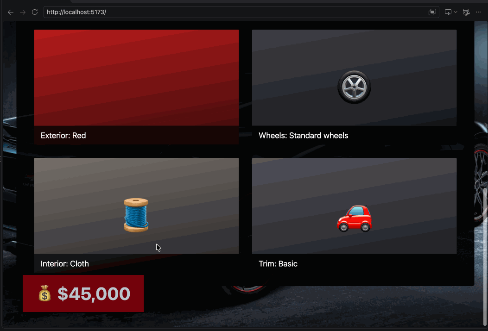
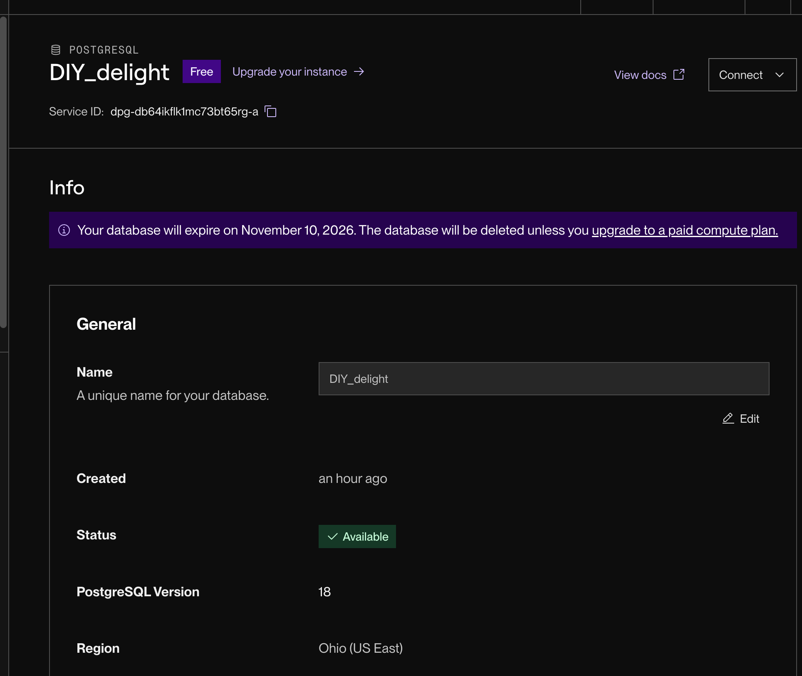
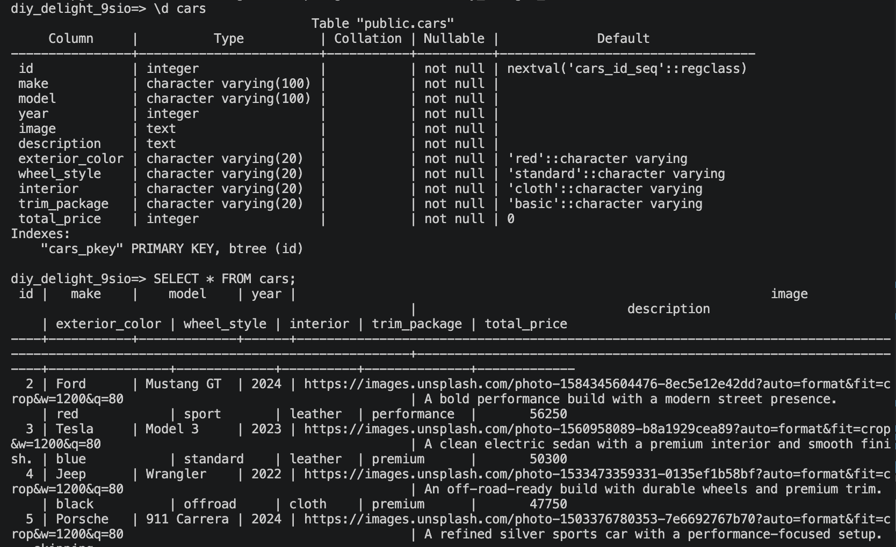

# WEB103 Project 4 - BOLT BUCKET

Submitted by: **Siyam Seid**

About this web app: **BOLT BUCKET is a React car customization app backed by an Express API and Render PostgreSQL. Users can configure, price, save, edit, and delete custom car builds.**

Time spent: **3**

## Required Features

The following **required** functionality is completed:

<!-- Make sure to check off completed functionality below -->
- [x] **The web app uses React to display data from the API.**
- [x] **The web app is connected to a PostgreSQL database, with an appropriately structured `CustomItem` table.**
  - [x]  **The walkthrough includes a view of the Render dashboard demonstrating that the Postgres database is available.**
  - [x]  **The walkthrough includes a demonstration of the table contents using `SELECT * FROM cars;`.**
- [x] **Users can view multiple features of the `CustomItem` (exterior color, wheels, interior, and trim).**
- [x] **Each customizable feature has multiple options to choose from.**
- [x] **On selecting options, the visual preview updates to match the exterior color and wheel choice.**
- [x] **The total price changes dynamically as different options are selected.**
- [x] **The visual interface changes in response to customizable features.**
- [x] **The user can submit their choices to save the item to the list of created `CustomItem`s.**
- [x] **Impossible feature combinations show an error and are rejected by the API.**
- [x] **Users can view a list of all submitted `CustomItem`s.**
- [x] **Users can edit a submitted `CustomItem` from the list view.**
- [x] **Users can delete a submitted `CustomItem` from the list view.**
- [x] **Users can update or delete `CustomItem`s from the detail page.**


The following **optional** features are implemented:

- [x] Selecting particular options prevents incompatible options from being selected even before form submission

The following **additional** features are implemented:

- [ ] List anything else that you added to improve the site's functionality!
- [x] Five starter cars are seeded into the database with image URLs, so the garage is populated on first load.
- [x] The database schema is initialized automatically when the server starts.

## Video Walkthrough

Here's a walkthrough of implemented required features:



### Render PostgreSQL dashboard



### PostgreSQL `cars` table contents



The table screenshot shows the result of:

```sql
SELECT * FROM cars;
```

## Notes

Describe any challenges encountered while building the app or any additional context you'd like to add.

## License

Copyright [yyyy] [name of copyright owner]

Licensed under the Apache License, Version 2.0 (the "License"); you may not use this file except in compliance with the License. You may obtain a copy of the License at

> http://www.apache.org/licenses/LICENSE-2.0

Unless required by applicable law or agreed to in writing, software distributed under the License is distributed on an "AS IS" BASIS, WITHOUT WARRANTIES OR CONDITIONS OF ANY KIND, either express or implied. See the License for the specific language governing permissions and limitations under the License.
